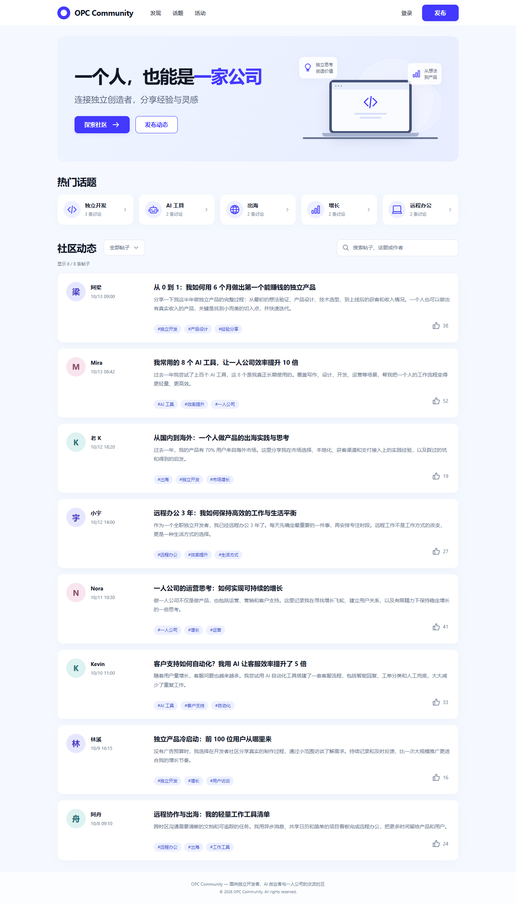
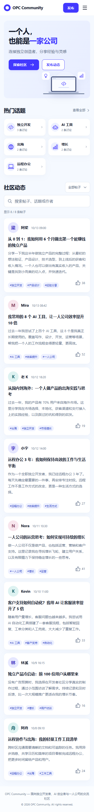
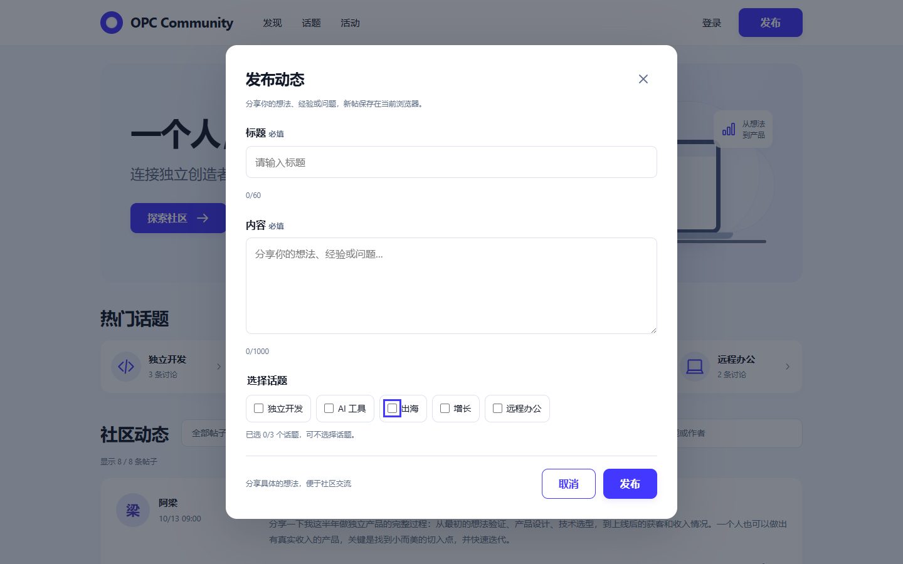

# OPC Community

OPC（One Person Company，一人公司）中文交流社区首页试岗项目，面向独立开发者、AI 创业者、自由职业者及一人公司经营者。以“一个人，也能是一家公司”为主题，完成 AI 设计迭代、原生前端实现、核心功能与回归验证。

当前状态：初始化、AI 设计和核心前端开发已完成，进入最终交付验收。桌面参考 desktop-v3，移动参考 mobile-v2，发布弹窗参考 publish-modal-v1；GitHub Pages 部署已完成（开发者在本轮任务中说明）；暗色模式已实现并于 2026-10-13 通过开发者亲自测试验收；本次确认未注明更新版线上部署情况。

## 技术栈与运行

HTML5、CSS3、JavaScript ES Modules、Vite Vanilla。无 React、Vue、Tailwind、后端、数据库或真实 AI API，仅 Vite 为项目开发依赖。

当前 Vite 的 Node.js 要求为 `^20.19.0 || >=22.12.0`；本机验证环境为 Node.js 24.19.0、Vite 8.3.4。首次获取项目时：

```sh
npm ci
npm run dev
```

构建和查看生产产物：

```sh
npm run build
npm run preview
```

`dev` 用于开发与热更新，`build` 生成 `dist/`，`preview` 本地预览构建结果，并非正式托管服务。请使用终端显示的地址；本轮验收开发地址为 `http://127.0.0.1:5176/`。发布功能使用兼容安全上下文与普通局域网 HTTP 环境的帖子 ID 生成方案：优先使用 crypto.randomUUID()，不可用时通过 crypto.getRandomValues() 生成 UUID v4。已完成 Windows 电脑 localhost 和 Android 手机局域网访问测试，发布功能均正常。

项目使用 Vite 开发服务器运行，不建议直接双击 index.html 文件。手机与电脑的数据分别保存在各自浏览器的 localStorage 中，不支持跨设备同步。

### 局域网与移动端调试

如需在同一局域网内使用手机访问开发中的网站，可在项目根目录执行：

```sh
npm run dev -- --host 0.0.0.0
```

该命令使 Vite 开发服务器监听所有网络接口。手机与电脑连接同一局域网后，可通过终端显示的 Network 地址访问，例如 `http://192.168.1.100:5173/`（示例地址，实际 IP 和端口以运行环境为准）。

如果无法访问，请检查 Windows 防火墙、电脑局域网 IP、网络隔离设置及 Vite 实际监听端口。该方式仅用于可信局域网内的开发测试，不建议直接暴露到公网。

## GitHub Pages 自动部署

在线预览：[https://williamjoyce1997.github.io/opc-community/](https://williamjoyce1997.github.io/opc-community/) — 开发者已说明项目完成部署；本轮主题更新仅在本地生产预览验证，尚未推送至线上。

`vite.config.js` 按执行方式设置基础路径：`npm run dev` 保持 `/`，`npm run build` 和 `npm run preview` 使用 `/opc-community/`。因此生产 JS/CSS 会从 `/opc-community/assets/` 加载。预览默认打开 `http://localhost:4173/opc-community/`；端口被占用时以终端输出为准，不要遗漏仓库子路径。

`.github/workflows/deploy.yml` 在推送到 `main` 时自动运行，也支持 Actions 页手动触发。构建任务使用 Node.js 24（满足现有 Vite 要求）、锁文件和 npm 缓存，依次执行 `npm ci`、`npm run build`，通过官方 Pages Actions 上传 `dist/`；部署任务依赖构建成功，使用 `github-pages` 环境及 `pages: write`、`id-token: write` 权限。仅 main 可部署，部署并发串行处理，避免中断正在进行的部署。Action 固定到官方示例的完整提交 SHA，升级时应核对官方版本。

开发者需要执行：

1. 在仓库 **Settings → Pages → Build and deployment → Source** 选择 **GitHub Actions**。
2. 确认 **Settings → Actions → General** 允许工作流使用这些官方 Actions；如组织限制 token 权限或环境部署，确保允许工作流声明的 Pages/OIDC 权限，并允许 `main` 部署到 `github-pages` 环境。如环境要求审批，批准对应部署。
3. 审查本轮修改，由开发者自行提交并推送到 `main`（保留并提交 `package-lock.json`）；本轮 Codex 未执行 commit 或 push。
4. 在 **Actions → Deploy to GitHub Pages** 查看 build 和 deploy 均成功；如需重跑，在 main 上选择 **Run workflow**。
5. 访问上方预览地址，检查资源请求无 404，以及导航、帖子、点赞、发布、搜索、筛选和刷新保存。确认后再把“待验证”改为“已验证”，并在 `ai-log.md` 记录真实部署与访问结果。

资源审查：`index.html` 的 `/src/main.js` 为 Vite 入口，构建会自动改写；CSS/JS 使用模块导入。页面导航和 SVG 图标使用 `#...`，favicon 为 data URI。`public/images/` 和 `src/assets/` 当前只有预留文件，没有需要修正的 public 地址。未来从 JavaScript 引用 `public/images/example.png` 时使用 `${import.meta.env.BASE_URL}images/example.png`，不要写死 `/images/example.png`，也不要把 `public/` 写入 URL。HTML 中可用 `%BASE_URL%images/example.png`；模块资源优先通过 import 引入。

本轮验证（2026-10-13）：`npm ci`、`npm run build`、`git diff --check` 通过。隔离 Edge 检查开发根路径 `http://127.0.0.1:5177/` 和生产预览 `http://127.0.0.1:4175/opc-community/`；生产桌面 1440px、手机宽度 390px 下的渲染、点赞、发布、搜索、话题筛选、导航及 localStorage 刷新持久化均通过，未发现 Console/pageerror 异常、请求失败或资源 404。手机宽度检查为桌面浏览器模拟，不等同于本轮手机真机线上测试。

localStorage 的键名和结构未变。它按来源（协议、域名、端口）隔离，子路径本身不隔离存储；localhost 和 GitHub Pages 的帖子/点赞不会自动迁移，发布仍是当前浏览器的本地演示数据。历史配置阶段未验证远端上线；开发者已在本轮说明项目部署完成。暗色页面已通过开发者人工测试；本次未提供具体浏览器、设备或访问地址，不据此宣称已完成 HTTPS 真机专项回归。

参考：[Vite 静态部署](https://vite.dev/guide/static-deploy.html)、[GitHub Pages 自定义工作流](https://docs.github.com/en/pages/getting-started-with-github-pages/using-custom-workflows-with-github-pages)。

## 已实现功能

- 暗色模式（可选加分功能）：桌面/手机导航 SVG 月亮与太阳按钮，首次跟随系统主题，手动选择单独保存；刷新保留，未手动选择时响应系统变化，支持键盘和减少动画偏好。

- 桌面和手机响应式布局；手机精简导航、两列话题、两行搜索工具栏和纵向帖子；整页自然滚动，Footer 位于完整列表后。
- 8 条固定 ID 的中文初始 Mock 帖子，包含作者、头像占位、发布时间、标题、正文、标签及点赞数量。
- 统一安全 DOM 动态渲染；用户输入作为纯文本，不插入用户 HTML。
- 每帖点赞/取消点赞，选中样式与 `aria-pressed`；个人点赞状态刷新保留，快速点击不重复累加。
- 原生发布 dialog：两个入口、标题/正文必填且不能只有空白，最长 60/1000 字，可选 0–3 个话题；X、取消、Esc 关闭，成功提示、新帖置顶及本地保存。
- 实时搜索标题、正文、作者和标签，英文大小写不敏感，话题空格规范化；无匹配显示空状态。
- 五个热门话题与六项下拉选择器共用筛选状态；选择反馈、按钮文字同步、菜单外部点击/Esc 关闭及方向键/Home/End/Enter/Space/Tab 操作。
- 搜索与话题取交集；选择“全部帖子”仅清除话题，保留搜索。发布成功会清空两者，确保新帖立即可见。
- 页内导航、可展开移动菜单；登录和活动按钮显示范围说明。
- localStorage 版本/字段校验、损坏数据与读写失败回退；同源标签顺序操作写前读取最新状态并接收存储更新，避免旧快照覆盖已保存新帖。

## 文件结构与职责

```text
opc-community/
├── index.html
├── package.json / package-lock.json
├── .gitignore
├── README.md
├── ai-log.md
├── src/
│   ├── main.js
│   ├── css/
│   │   ├── style.css
│   │   └── responsive.css
│   ├── js/
│   │   ├── data.js
│   │   ├── posts.js
│   │   ├── modal.js
│   │   ├── filters.js
│   │   ├── storage.js
│   │   └── theme.js
│   └── assets/
├── public/images/
├── design/
└── screenshots/
```

| 文件/目录 | 当前职责 |
| --- | --- |
| `index.html` | 语义化首页、唯一 `#posts-list`、内联图标、菜单与原生 dialog |
| `src/main.js` | 初始化模块、内存状态、持久化组织、发布后重置、通知及导航 |
| `src/js/data.js` | 8 条初始帖子、五个话题及名称规范化 |
| `src/js/posts.js` | 安全创建卡片、空状态、点赞事件代理和按钮更新 |
| `src/js/modal.js` | 弹窗打开关闭、字数/空白/话题校验与发布回调 |
| `src/js/filters.js` | 搜索与话题组合过滤、下拉键盘/焦点、卡片和菜单同步 |
| `src/js/storage.js` | 帖子存储校验/异常回退，以及独立主题键的安全读写 |
| `src/js/theme.js` | 主题切换、动态无障碍标签、系统偏好与跨标签同步 |
| `src/css/style.css` | 全局变量、桌面组件、交互状态、焦点及弹层样式 |
| `src/css/responsive.css` | 手机和中尺寸重排、移动菜单和下拉定位 |
| `src/assets/`、`public/images/` | 预留独立资源位置，目前没有外部人物插画或头像 |
| `design/` | 原始 AI 设计图及历史迭代，不能当作网页截图 |
| `screenshots/` | 实际运行截图，历史静态及功能截图保留 |
| `ai-log.md` | 原始提示词、AI 输出、设计/代码评审、修复与验证证据 |

`.gitignore` 排除 `node_modules/`、`dist/`、日志及 `.env`/`.env.*`，保留 `.env.example` 例外。本轮未提交或推送。

## AI 工具与设计迭代

| 工具 | 实际分工 |
| --- | --- |
| GPT Image | 生成与优化首页及发布弹窗设计图 |
| ChatGPT | 静态 UI 评审、设计迭代建议，辅助开发者确定参考稿 |
| Codex | 检查项目、实现原生模块、定位修复、代码评审、浏览器回归及日志整理 |

这些是开发过程使用的工具，网页没有接入在线 AI 服务。

| 设计产物 | 迭代说明 |
| --- | --- |
| [桌面 V1](design/desktop-v1.png) | 初始品牌、Hero、话题和五帖布局 |
| [桌面 V2](design/desktop-v2.png) | 增至六帖，移除无需求省略号，加入全部帖子入口 |
| [桌面 V3](design/desktop-v3.png) | 明确宽屏结构、压缩间距与调整摘要，开发者已确认桌面定稿 |
| [移动 V1](design/mobile-v1.png) | 风格统一但偏平板，作者分栏和工具栏拥挤 |
| [移动 V2](design/mobile-v2.png) | 手机目标约 390px、纵向信息与独立搜索行，开发者已确认移动定稿 |
| [发布弹窗 V1](design/publish-modal-v1.png) | 已确认静态设计参考；实际代码补充输入规则、关闭和保存 |

实际实现采用独立 SVG 图标、简洁工作台 Hero 及字母头像占位，没有把整张设计图当背景或裁切组件。设计图帖子数量仅表示视觉示例，实际初始数据为 8 条。

## 实际使用的关键提示词

以下为开发者实际使用原文的关键节选，完整内容与当轮结果在 [AI 协作日志](ai-log.md)。节选不是完整原文或新增改写。

| 编号 | 实际原文节选 | 完整记录 |
| --- | --- | --- |
| P01 | “这是用于前端开发的设计参考图，不是宣传海报。” | [桌面 V1 原文](ai-log.md#p01桌面端-v1) |
| P03 | “画布必须体现桌面端宽度，整体观感应是‘宽屏网页’而不是‘窄长竖图’。”（引号展示规范化） | [桌面 V3 原文](ai-log.md#p03桌面端-v3) |
| P06 | “第一行展示‘社区动态’标题和‘全部帖子’筛选入口。”“第二行单独展示全宽搜索框。”（引号展示规范化） | [移动 V2 原文](ai-log.md#p06移动端-v2) |
| C03 | “使用 textContent 或安全 DOM API 处理用户输入，避免 HTML 注入。” | [核心开发原文](ai-log.md#使用工具与实际提示词-c03) |
| C04 | “继续复用现有 filterPosts() 和 initFilters()，不要重复实现另一套筛选系统。” | [下拉修复原文](ai-log.md#实际提示词-c04) |

P01–P06 六条设计生成原文全部归档；C01–C04 保留实际代码任务。历史“待补充”是当轮状态，不冒充当时已经取得原文。

## 最终实际页面截图

以下于最终代码评审回归时通过本机 Edge 实际运行生成，不是 GPT Image 设计图。最终截图使用隔离浏览器的初始八帖，开发者本机新增帖数量可不同；旧截图仍保留。

桌面端，1440px：



移动端，390px：



实际发布弹窗：



[390px 发布弹窗](screenshots/final-modal-390.png) · [手机筛选菜单](screenshots/final-filter-390.png) · [桌面筛选菜单](screenshots/final-filter-1440.png)

## 验证与人工确认

开发者已明确确认：点赞 38→39 及样式、发布新帖置顶、作者阿梁搜索、话题及“全部帖子”修复、刷新保留新帖/点赞、发布必填与非法输入校验。以上是开发者提供的人工结论。

Codex 在隔离 Edge 会话执行了八帖、点赞/快速切换/刷新、发布边界、纯文本注入防护、搜索与组合筛选、下拉键盘及关闭、手机导航、损坏/不可用存储回退、双标签顺序操作和五视口检查；没有访问开发者日常浏览器数据。自动化验证与截图不冒充人工视觉验收。详细结果及严重程度见文末最新 [正式评审日志](ai-log.md#final-code-review)。

本机验证宽度：375、390、768、1024、1440px；页面无横向溢出，弹窗宽度适配，未发现 Console 异常或失败资源请求。`npm run build` 和 `git diff --check` 已通过。测试使用现有运行环境的临时脚本，仓库未提供 `npm test` 命令。

## 暗色模式与本轮验证

主题由 `document.documentElement.dataset.theme` 控制。HTML 头部在主体绘制前读取偏好；组件沿用 CSS 变量，仅覆盖暗色值。主题键 `opc-community:theme:v1` 只保存 `light` 或 `dark`，不改写帖子/点赞的 `opc-community:state:v1`。存储不可用时仍可切换，并提示刷新可能恢复系统主题。没有主题偏好时跟随系统，手动选择后以用户选择为准。

隔离 Edge 在生产子路径 `/opc-community/` 下验证浅色/暗色切换、刷新、首次系统偏好、后续系统变化、键盘、存储不可用回退，以及暗色下发布/点赞/搜索/话题组合与原有数据保留；320、375、390、768、1024、1440px 无横向溢出，资源与 Console 检查通过。浏览器模拟不等同于手机真机。上述为 Codex 自动化结果。2026-10-13，开发者补充确认：“我已经亲自测试了暗色页面，一切正常，通过。”暗色模式人工验收已通过；本次确认未列出具体设备、浏览器和访问地址。Codex 未执行提交、推送或重新部署。

[暗色桌面运行截图](screenshots/dark-home-1440.png) · [暗色手机运行截图](screenshots/dark-home-390.png) · [桌面弹窗](screenshots/dark-modal-1440.png) · [手机弹窗](screenshots/dark-modal-390.png)。截图包含隔离回归时发布的测试帖，历史截图保留。

## 已知边界、取舍与待确认建议

- localStorage 是当前浏览器、当前来源的本地演示存储，不支持多设备同步。不同端口也是不同来源；切换预览端口不会自动迁移旧帖。清除站点数据、无痕窗口关闭或浏览器策略可能丢失数据。
- 保存失败时操作继续保留在本页内存，并提示刷新可能丢失；不会假报落盘成功。无效存储条目会被忽略，版本损坏时使用安全回退。
- 已修复可复现的“另一标签使用旧快照删除新帖”问题；localStorage 没有事务锁，完全同一瞬间的跨标签写入仍不保证事务一致性。是否增加更复杂并发控制为 P2 建议，待人工确认，本轮不重构。
- Hero 与头像仍为明确占位方案，并非逐像素复制设计稿。进一步替换独立插画、提升小字号及统一更细的间距属于非阻断视觉优化，待人工确认。
- 完整读屏软件、真实 iOS/Safari/Firefox 和手机软键盘未实测；目前不能宣称全平台可访问性验收完成。请交付前人工确认这些环境与视觉效果。
- 搜索实时重建当前列表，适合小规模演示；初始 Mock 不反复写入存储，个人点赞由基础数加个人状态计算。字数按 Unicode 码点计，去掉首尾空白后校验。
- 登录和活动仅显示说明，不提供真实认证或活动页面。真实后端、数据库、在线发布、支付、收藏和复杂动画均在本次项目范围之外。

## 交付检查

六张原始设计图齐全，最终首页/手机/弹窗运行截图齐全，README 引用对应真实文件；依赖与构建产物已忽略。最终 P0 未发现，确认的 P1 已最小修复并回归。项目具备本地演示交付条件；最终验收与提交/推送由开发者决定，本轮未自动执行。
